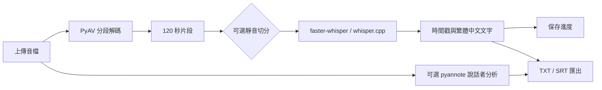

# MP3 Transcriber｜可恢復進度的本機逐字稿工具

以 Python 與 Streamlit 製作的繁體中文語音轉文字工具，針對課堂錄音等長音檔提供分段轉錄、進度保存、暫停與繼續，以及 TXT／SRT 匯出。辨識使用現有 Whisper 模型，專案重點在於把模型整合成可以持續操作、觀察與恢復的應用程式。

## 開發動機

長時間錄音的整理不只需要「辨識出文字」。模型下載與推論需要等待，整段音訊處理可能造成記憶體壓力，意外中斷也可能讓已完成的工作消失。本專案由實際使用需求出發，逐步加入分段解碼、工作狀態保存、部分結果下載與效能比較，探索速度、資源使用和可靠性之間的取捨。

## 主要功能

| 功能 | 說明 |
| --- | --- |
| 本機轉錄 | 使用 faster-whisper，提供多種模型與推論模式，主要測試環境為 Windows CPU |
| 長音檔分段 | 以 PyAV 逐段解碼，每段約 120 秒，降低一次解碼完整錄音的記憶體壓力 |
| 工作管理 | 暫停、繼續、停止、保存與恢復工作；可下載已完成的部分結果 |
| 進度顯示 | 區分已處理音檔長度、工作經過時間與實際轉錄耗時 |
| 匯出 | 繁體中文純文字、附時間戳文字與 SRT 字幕 |
| 可選並行 | 在兩分鐘片段中尋找靠近中點的靜音，再將兩側並行辨識，可於執行期間切換 |
| 可選引擎 | 可指定外部 whisper.cpp CLI 與 GGML 模型；不附帶 Buzz 執行檔或模型 |
| 實驗性說話者標記 | 整合 pyannote，提供手動、轉錄同時、暫停時或完成後啟動的設定 |

## 快速開始（Windows）

建議安裝 Python 3.12（包含 Python Launcher）。取得原始碼後，在專案資料夾雙擊 `啟動.cmd`。啟動器會建立虛擬環境、安裝基本套件並啟動本機網頁。首次使用模型需要網路下載與足夠磁碟空間。

也可以在專案資料夾的 PowerShell 執行：

```powershell
py -3.12 -m venv .venv
.\.venv\Scripts\python.exe -m pip install -r requirements.txt
.\.venv\Scripts\python.exe -m streamlit run app.py --server.address 127.0.0.1 --server.maxUploadSize 1024 --browser.gatherUsageStats false
```

1. 上傳自己有權使用的 MP3 錄音或 MP4 影片，選擇模型、語言與模式。
2. 開始轉錄，從畫面觀察進度；需要時暫停或下載部分結果。
3. 完成後下載逐字稿或字幕，並校對專有名詞與時間戳。
4. 稍後可從已保存工作恢復；刪除工作會刪除該工作的本機資料。

執行期間請保留啟動程式的終端機。關閉終端機會中止服務；重新啟動後，可從保存點恢復，最後未完成的片段可能需要重新辨識。

MP4 直接讀取第一條音軌，不必預先轉成 MP3；不辨識畫面或畫面中的字幕。沒有音軌的影片會顯示錯誤。影片與錄音共用分段、暫停、恢復和匯出流程。啟動指令的上傳限制為每個檔案 1024 MB；保存工作會保留原始影片，因此需預留磁碟空間。時間戳以解碼後的音軌起點為準，不保證保留影片容器的特殊起始偏移。

### 選用：說話者分段

```powershell
.\.venv\Scripts\python.exe -m pip install -r requirements-speakers.txt
```

至 [Community-1 模型頁](https://huggingface.co/pyannote/speaker-diarization-community-1)自行閱讀並接受模型使用條件，再於程式輸入 Hugging Face Read 權杖。Windows 可使用程式提供的本機加密保存功能；不要把權杖寫進程式碼或 GitHub。

此功能標記匿名說話者，不會辨認真實姓名。每批只分析已產生逐字稿的音訊範圍（通常不超過約兩分鐘），完成後立即合併標籤並保存進度。

- **每次暫停時開始：** 等轉錄實際暫停後，擷取當下的文字範圍，只處理尚未辨識的部分。再次暫停會延伸本次目標。
- **手動辨識：** 不必等整份轉錄完成；按下按鈕時固定本次範圍，下次從已保存的段落繼續。
- **與轉錄同時開始：** 等待新文字，隨轉錄暫停／繼續；在解碼與模型階段檢查點生效，無法立即中斷正在執行的單次運算或模型下載。轉錄正常完成後會處理剩餘文字；停止或失敗則停止同步分析。
- **轉錄完成後開始：** 轉錄完成後分批補齊尚未標記的文字。

重新啟動轉錄若重做最後未完成片段，該片段的說話者進度也會回退，避免套用過期標籤。不同分析區段的說話者編號是獨立的，標籤會附區段起點，不代表跨段聲紋身分已比對。舊工作已有的標籤會保留。

目前區段解碼會從檔案起點逐段略過前面的樣本，但模型只分析本次選取區段，不重新辨識已完成區段。後段工作的解碼成本仍有改善空間。

## 系統設計



- **記憶體管理：** 語音轉錄採分段讀取，避免將整份錄音一次送入特徵處理；模型本身仍需足夠記憶體。
- **持久化：** 使用暫存檔與原子替換保存工作；一般文字更新最多每五秒保存一次，分段完成等關鍵事件強制保存。這是收到新結果時檢查間隔，並非獨立的五秒定時器。
- **並行策略：** 使用 20 ms 音框估計音量，尋找至少 0.5 秒、低於 −35 dBFS 且盡量接近中點的內部靜音。此音量門檻與模型的語音活動偵測（VAD）是不同機制。
- **恢復策略：** 保存完成的片段與參數，重新啟動時從保存點繼續；不保存模型在一次推論中的內部計算狀態。
- **憑證管理：** 使用 Windows DPAPI 保存可選的 Hugging Face 權杖，檔案不納入版本控制。

## 效能實驗：以量測決定取捨

以下是開發期間的本機測試紀錄，並非本次發布重新執行的推論測試。每組樣本有限，不代表所有電腦或錄音。原始課堂錄音與逐字稿不公開。

### CPU 執行緒數

同一段 120 秒中文錄音，Turbo、CPU INT8、beam size 5、batch size 2、單一工作、關閉切分並行。先暖機，排除模型載入與解碼，每種設定測一次。

| 執行緒 | 辨識耗時 |
| ---: | ---: |
| 2 | 47.71 秒 |
| 4 | 41.36 秒 |
| 6 | 57.43 秒 |
| 8 | 50.27 秒 |

四執行緒在此樣本最快；增加執行緒沒有持續加速。這支持在本機以實測選擇參數，不能直接推廣至其他硬體。

### 靜音切分並行與保存策略

| 實驗 | 原設定 | 比較設定 | 觀察 |
| --- | --- | --- | --- |
| 同一兩分鐘片段，切分並行 | 關閉：64.83 秒 | 開啟：68.52 秒 | 約慢 5.7%，因此維持可選且預設關閉 |
| 三個兩分鐘片段，保存策略 | 逐句保存：233.89 秒／23 次 | 間隔保存：234.67 秒／15 次 | 寫入次數減少約 35%，沒有證實轉錄加速 |

保存實驗的三段靜音比例分別為 19.8%、21.2%、20.4%，採交替執行順序。保存測試使用模擬狀態資料，不等同完整長工作負載；兩組文字相同也不等於辨識正確率。尚未建立人工校對資料集或計算 CER／WER。

## 原始碼導覽與驗證

| 檔案 | 職責 |
| --- | --- |
| `app.py` | Streamlit 操作介面、進度與匯出 |
| `transcription_job.py` | 背景工作、保存與恢復、暫停與停止 |
| `audio_chunks.py` | 分段解碼與取樣率處理 |
| `parallel_segments.py` | 靜音搜尋、雙段並行與時間偏移 |
| `whisper_cpp_engine.py` | 外部 whisper.cpp CLI 介接 |
| `speaker_diarization.py` | 說話者分段與逐字稿標籤配對 |
| `speaker_token_store.py` | Windows 權杖加密保存 |
| `test_*.py` | 工作流程、切分與引擎介接單元測試 |

安裝基本依賴後，在專案資料夾執行：

```powershell
.\.venv\Scripts\python.exe -m unittest discover -p "test_*.py"
```

單元測試以替身模擬部分模型行為，不代表真實模型的正確率或完整 GUI 已經驗證。

## 限制與後續方向

- 已針對數個短片段量測，但尚未完成三小時音檔的系統性壓力測試與多硬體比較。
- 說話者分析分批保留音訊，重複啟動時仍需重新載入模型；同步暫停採合作式檢查點，非立即強制中斷。跨區段說話者身分尚未串接。
- 說話者標籤按文字片段中點配對，不會切開一句中途換人的文字；多人重疊、短句與相近聲線需要另外評估。
- 分段邊界、背景聲音、專有名詞與模型幻覺可能影響內容，輸出需要人工校對。
- Windows 是目前主要驗證平台；GPU 效能與其他作業系統相容性尚未完整驗證。依賴使用版本範圍，並非完全鎖定的可重現環境。
- 後續可建立人工校對測試集、增加推論重複次數與記憶體量測，並改善說話者分析的進度、取消及長音檔處理。

## 資料與隱私

轉錄推論在本機執行。首次下載模型及權杖驗證需要連線；第三方套件也可能有自己的網路或遙測行為，本專案不宣稱完全離線或零網路傳輸。

`saved_jobs/` 包含原始音檔與逐字稿，`models/` 包含模型，`.speaker-token.dpapi` 包含加密憑證。這些檔案與虛擬環境、測試原始逐字稿均不應上傳。本儲存庫僅包含經挑選的程式與文件，不包含課堂錄音、私人逐字稿或模型權重。

## 開發角色與參考專案

這是 AI 輔助開發的個人應用專案：由專案作者提出使用情境、功能需求、測試條件與迭代方向，使用 Codex 協助撰寫、修改程式及執行測試。語音模型與推論引擎來自既有專案，未自行訓練 Whisper。作品重點為需求拆解、系統整合、故障處理與實驗判讀；閱讀者可透過原始碼與測試了解實作範圍。

README 的組織參考以下專案呈現功能、安裝、架構與評測的方法；沒有沿用它們的速度或正確率作為本專案成果：

- [Buzz](https://github.com/chidiwilliams/buzz)：參考使用者導向的功能與安裝介紹，以及多引擎應用方式。
- [faster-whisper](https://github.com/SYSTRAN/faster-whisper)：主要推論依賴，參考明列模型、硬體與參數的效能表述。
- [WhisperX](https://github.com/m-bain/whisperX)：參考管線圖、說話者分段及限制的說明；本專案未整合其強制對齊功能。
- [OpenAI Whisper](https://github.com/openai/whisper)、[whisper.cpp](https://github.com/ggml-org/whisper.cpp)、[pyannote.audio](https://github.com/pyannote/pyannote-audio)、[Streamlit](https://github.com/streamlit/streamlit)、[PyAV](https://github.com/PyAV-Org/PyAV)、[OpenCC](https://github.com/BYVoid/OpenCC)：模型、引擎與工具的上游來源，相關授權與模型使用條件依各專案規定。

本儲存庫目前未另行指定整體開源授權；公開原始碼不代表取消上游授權或模型使用限制。
